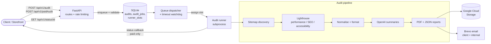

# Valvanta Audit API

> A production FastAPI service that audits entire websites for **performance, SEO and accessibility**, turns the results into branded PDF/JSON reports, stores them in Google Cloud Storage, and emails them to clients through Brevo. Built for [Valvanta Digital](https://valvanta.com) and used to power both the free and paid audit products.


## Highlights

- **End to end pipeline**: sitemap discovery → Lighthouse runs → normalisation → AI summaries → PDF/JSON reports → cloud upload → email delivery.
- **Custom job queue** backed by SQLite with tier-aware scheduling, a fixed pool of runner slots, anti-starvation rules and a timeout watchdog (no Celery or Redis required).
- **Two product tiers** (free and paid) with different URL limits, report contents, timeouts and email behaviour.
- **Webhook callbacks** notify the storefront when a paid audit completes or fails, authenticated with a shared secret.
- **Production concerns covered**: rate limiting, structured JSONL audit logging, artifact cleanup, consistent `HTTPException` error handling and resendable results.
- **Documented and tested**: every module and function is documented, with a pytest suite covering the accessibility flow, rate limiting, email templates, PDF upsell and resend.

## Architecture



### How the queue works

Jobs are never run directly from a request. Every audit goes through the queue in `app/audit_queue/`:

1. **Enqueue**: the request is validated, the target domain is normalised (to detect repeat audits of the same site), and a job is stored with its tier.
2. **Dispatch**: queued jobs are assigned to free **runner slots**. Selection order is oldest paid job that has been skipped 5 times, then oldest free job, then oldest paid job. While a paid job is running, the remaining slot only accepts free jobs, so one heavy audit cannot starve everyone else.
3. **Run**: the audit executes in a subprocess, reports are uploaded to GCS, and emails are sent.
4. **Watchdog**: jobs exceeding their tier's timeout (30 min free, 120 min paid) are marked `timeout` and their slot is released.
5. **Status**: callers poll a public job token (or audit id) via `GET /api/v1/status/{identifier}`.

## Tiers

|                     | Free              | Paid                              |
| ------------------- | ----------------- | --------------------------------- |
| Max URLs            | 5                 | 100                               |
| Reports             | Performance + SEO | Performance + SEO + Accessibility |
| Emails              | Client + company  | Company only                      |
| Timeout             | 30 minutes        | 120 minutes                       |
| Completion callback | n/a               | Optional `callbackUrl`            |

## Tech Stack

| Area            | Tools                                                 |
| --------------- | ----------------------------------------------------- |
| API             | FastAPI, Uvicorn, Pydantic                            |
| Persistence     | SQLAlchemy 2.0, SQLite                                |
| Auditing        | Lighthouse 13 (headless Chrome)                       |
| Reporting       | ReportLab (PDF), Pillow, Inter and Kaisei Decol fonts |
| AI              | OpenAI API (audit summaries)                          |
| Cloud and email | Google Cloud Storage, Brevo                           |
| Testing         | pytest                                                |

## Project Structure

```
AuditAPI/
├── app/
│   ├── main.py                  # App setup, middleware, audit runner (subprocess, GCS upload, emails, callback)
│   ├── database.py              # SQLAlchemy engine + session
│   ├── models.py                # Pydantic / ORM models
│   ├── rate_limit.py            # Rate limiting middleware
│   ├── logging_utils.py         # Structured JSONL audit logging
│   ├── cleanup.py               # Cleanup of old local audit artifacts
│   ├── routes/
│   │   ├── audit.py             # Audit, status and resend endpoints
│   │   ├── email.py             # Generic email send
│   │   └── brevo.py             # Newsletter / audit list signup
│   ├── audit_queue/
│   │   ├── service.py           # Validation, enqueue, dispatch, watchdog, status
│   │   ├── worker.py            # Background queue worker
│   │   └── models.py
│   ├── audit_service/
│   │   ├── cli.py               # Run a full audit from the command line
│   │   ├── audit/               # Sitemap discovery, Lighthouse, normaliser, formatters
│   │   ├── ai/                  # OpenAI request + response schema
│   │   ├── reports/             # PDF generator, layout, styles and report sections
│   │   ├── writers/             # JSON output
│   │   └── config/              # Settings
│   ├── emails/
│   │   ├── brevo_email.py       # Brevo integration
│   │   ├── send_test_emails.py  # Send every template to a test inbox
│   │   └── templates/           # Client + company HTML templates
│   ├── gcs/
│   │   └── uploader.py          # Upload / download helpers
│   └── assets/                  # Fonts and images used in PDF reports
├── tests/                       # pytest suite
├── storage/                     # SQLite database (runtime)
├── audit_results/               # JSON / PDF output (runtime)
├── requirements.txt
└── package.json                 # Lighthouse dependency
```

## Getting Started

### Prerequisites

- Python 3.11+
- Node.js (for Lighthouse)
- Chrome or Chromium installed

### Install

```bash
python -m venv venv
source venv/bin/activate
pip install -r requirements.txt
npm install
```

### Run the API

```bash
uvicorn app.main:app --reload
```

Interactive API docs are served by FastAPI at `http://localhost:8000/docs`.

### Run a full audit from the CLI

```bash
python app/audit_service/cli.py \
  --client-name "Acme" \
  --domain-url https://example.com \
  --only-categories seo,performance \
  --max-urls 50
```

Other flags: `--audit-id`, `--output-dir`, `--log-path`, `--debug-mode`.

### Run the tests

```bash
pytest
```

## Configuration

Set these in a `.env` file or your environment.

**Email (required)**

| Variable              | Description                               |
| --------------------- | ----------------------------------------- |
| `BREVO_API_KEY`       | Brevo API key                             |
| `BREVO_SENDER_EMAIL`  | Sender address                            |
| `BREVO_SENDER_NAME`   | Optional, default `Valvanta Digital`      |
| `BREVO_COMPANY_EMAIL` | Optional, receives internal notifications |

**Cloud Storage (required for uploads and resend)**

| Variable                   | Description                  |
| -------------------------- | ---------------------------- |
| `GCS_BUCKET_NAME`          | Destination bucket           |
| `GCS_SERVICE_ACCOUNT_JSON` | Path to service account JSON |

**Paid audit callbacks**

| Variable                    | Description                                                                                                |
| --------------------------- | ---------------------------------------------------------------------------------------------------------- |
| `VALVANTA_AUDIT_SECRET_KEY` | Sent as the `Authorization` header when POSTing status to `callbackUrl`. The callback is skipped if unset. |

**Brevo list signup**

| Variable                          | Description                     |
| --------------------------------- | ------------------------------- |
| `BREVO_NEWSLETTER_SIGNUP_LIST_ID` | Used by `/api/signupNewsletter` |
| `BREVO_AUDIT_SIGNUP_LIST_ID`      | Used by `/api/signupAuditList`  |

**Optional**

| Variable                    | Description                                                                                      |
| --------------------------- | ------------------------------------------------------------------------------------------------ |
| `OPENAI_API_KEY`            | Enables AI summaries                                                                             |
| `CHROME_PATH`               | Chrome/Chromium binary for Lighthouse. Auto-detected if unset; the audit fails if none is found. |
| `RATE_LIMIT_DISABLED`       | `1`, `true` or `True` disables rate limiting (default: enabled)                                  |
| `RATE_LIMIT_REQUESTS`       | Max requests per window (default `30`)                                                           |
| `RATE_LIMIT_WINDOW_SECONDS` | Window length in seconds (default `60`)                                                          |

## API Reference

### Start a free audit (queued)

```http
POST /api/v1/audit
```

```json
{
  "url": "https://example.com",
  "email": "client@example.com",
  "client_name": "Acme Co"
}
```

### Start a paid audit (queued)

Field names are camelCase. `socialLinks`, `orderId` and `callbackUrl` are required. `callbackUrl` receives a status POST (`{"orderId", "status"}`, authenticated with `VALVANTA_AUDIT_SECRET_KEY`) when the audit completes or fails.

```http
POST /api/v1/paidAudit
```

```json
{
  "customerName": "Acme Co",
  "customerEmail": "client@example.com",
  "websiteUrl": "https://example.com",
  "socialLinks": ["https://twitter.com/acme"],
  "orderId": "order_123",
  "callbackUrl": "https://example.com/audit-callback"
}
```

### Check status (job token or audit id)

```http
GET /api/v1/status/{identifier}
```

### Resend a completed audit email

Downloads the reports from GCS and re-sends them. You can use `target_url` instead of `job_id`.

```http
POST /api/v1/audit/resend
```

```json
{
  "job_id": "...",
  "to_email": "optional-override@example.com"
}
```

### Send a generic email

Used internally, for example for one-off notifications.

```http
POST /api/sendEmail
```

```json
{
  "to_email": "client@example.com",
  "send_email": "sender@valvanta.com",
  "subject_line": "Subject",
  "html_content": "<p>Hello</p>",
  "attachments": "optional/path/one.pdf,optional/path/two.pdf"
}
```

### Mailing list signup

Newsletter list (requires `BREVO_NEWSLETTER_SIGNUP_LIST_ID`) and audit list (requires `BREVO_AUDIT_SIGNUP_LIST_ID`) take the same body:

```http
POST /api/signupNewsletter
POST /api/signupAuditList
```

```json
{
  "name": "Jane Doe",
  "email": "jane@example.com"
}
```

## Email Template Testing

Send every template to a test inbox:

```bash
python -m app.emails.send_test_emails --to-email you@example.com
```

## License

Released under the [MIT License](LICENSE).
